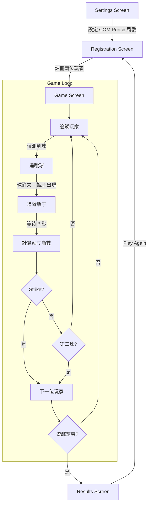

# Bowling Scorer Web Application - Walkthrough

完成了一個網頁版保齡球計分系統，整合了現有的 YOLO 偵測、玩家識別、以及 Arduino 雲台追蹤功能。

---

## 🎳 專案成果

### 新建檔案

| 檔案 | 說明 |
|------|------|
| [app.py](file:///Users/ken/Desktop/final_project_intro_to_ai/app.py) | Flask + SocketIO 主伺服器 |
| [game_manager.py](file:///Users/ken/Desktop/final_project_intro_to_ai/game_manager.py) | 遊戲邏輯與標準保齡球計分 |
| [templates/index.html](file:///Users/ken/Desktop/final_project_intro_to_ai/templates/index.html) | 網頁主頁面 |
| [static/style.css](file:///Users/ken/Desktop/final_project_intro_to_ai/static/style.css) | 現代深色主題 CSS |
| [static/app.js](file:///Users/ken/Desktop/final_project_intro_to_ai/static/app.js) | 前端 JavaScript |

### 修改檔案

| 檔案 | 變更 |
|------|------|
| [requirements.txt](file:///Users/ken/Desktop/final_project_intro_to_ai/requirements.txt) | 新增 `flask`, `flask-socketio` |

---

## 📸 UI 截圖

### Settings Screen


---

## 🚀 How to Run

```bash
# 啟動 conda 環境
conda activate bowling_env

# 執行應用程式 (使用 port 5001 避免 AirPlay 衝突)
python app.py --port 5001

# 開啟瀏覽器
# http://localhost:5001
```

---

## 🎮 遊戲流程



---

## 🏗️ Architecture

**關鍵設計：追蹤迴路不經過網頁**

```
┌─────────────────────────────────────────────────┐
│              Python Backend (本機)               │
│                                                  │
│  Camera ──▶ YOLO ──▶ Arduino Control ──▶ 雲台   │
│              │            (直接 Serial)          │
│              │                                   │
│              ▼ (已處理的畫面)                     │
│         WebSocket                                │
└──────────────┬──────────────────────────────────┘
               ▼
         ┌───────────┐
         │ 網頁 UI   │  ◀── 只負責「顯示」
         └───────────┘
```

- **追蹤速度**：與 [track_test.py](file:///Users/ken/Desktop/final_project_intro_to_ai/track_test.py) 完全相同（無延遲）
- **網頁顯示**：約 30 FPS，可能有 50-100ms 延遲（不影響追蹤）

---

## ✅ 已實作功能

- [x] **Settings Screen** - COM port、Camera Source、局數設定
- [x] **Player Registration** - 透過 YOLO + ReID 註冊玩家
- [x] **即時影像串流** - 主畫面顯示 YOLO 標註的影像
- [x] **Player Crop Overlay** - 右上角 1/4 畫面顯示當前玩家
- [x] **標準保齡球計分** - Strike/Spare/10th frame 特殊規則
- [x] **Scoreboard** - 即時更新的計分板
- [x] **Score Correction** - 可修正上一球的瓶數
- [x] **Game Results** - 顯示贏家並可重新開始
- [x] **Arduino 整合** - 透過 [CameraTracker](file:///Users/ken/Desktop/final_project_intro_to_ai/arduino_control.py#23-361) 控制雲台

---

## 📝 Notes

1. **Port 5000 衝突**：Mac 的 AirPlay Receiver 會佔用 port 5000，請使用 `--port 5001`
2. **首次啟動**：需等待 YOLO 和 ReID 模型載入（約 5-10 秒）
3. **Arduino 連接**：在 Settings 中設定正確的 COM port，遊戲開始時會自動連接
